<a href="https://uxe.fyi">
  <picture>
    <source media="(prefers-color-scheme: dark)" srcset=".github/assets/banner-dark.svg">
    <source media="(prefers-color-scheme: light)" srcset=".github/assets/banner-light.svg">
    
  </picture>
</a>

<p align="center">
  <b>The open-source home for UX Engineering.</b><br>
  A living handbook, a career bridge, and a community for people who care how interfaces <i>feel</i>.
</p>

<p align="center">
  <a href="https://uxe.fyi"><b>uxe.fyi</b></a> ·
  <a href="https://uxe.fyi/explore">What is UXE?</a> ·
  <a href="https://uxe.fyi/breakdowns">Breakdowns</a> ·
  <a href="#-come-build-it-with-us">Contribute</a> ·
  <a href="https://github.com/sidhanshumonga/uxe.fyi/issues?q=is%3Aissue+is%3Aopen+label%3A%22good+first+issue%22">Good first issues</a>
</p>

<p align="center">
  <a href="https://github.com/sidhanshumonga/uxe.fyi/actions/workflows/ci.yml"></a>
  <a href="LICENSE"></a>
  <a href="LICENSE-CONTENT"></a>
  <a href="CONTRIBUTING.md"></a>
  <a href="https://github.com/sidhanshumonga/uxe.fyi/stargazers"></a>
</p>

---

## 👋 You might be a UX Engineer if…

- you've nudged an animation from `300ms` to `220ms` and felt the whole product get calmer
- you've argued for an optimistic update, and won, and nobody noticed. That was the point.
- you have opinions about `cubic-bezier(0.16, 1, 0.3, 1)`
- you've filed a bug titled *"focus ring disappears after the modal closes"* and fixed it before lunch
- designers think you're an engineer, engineers think you're a designer, and both are a bit right
- you've opened DevTools on someone else's site just to see how the hover state was built

If two or more of those landed, **this project is for you.** UX Engineering is the craft between engineering, design and human behavior. It has never had a proper home, a shared vocabulary, or a clear path in. uxe.fyi is trying to be all three, and it's written in the open by the people who do the work.

## 🧭 What's inside

| | Section | What it is | Status |
|---|---|---|---|
| 🔭 | [**Explore**](https://uxe.fyi/explore) | What UX Engineering is, how it differs from frontend, design and product engineering, and a day in the life | ✅ live |
| 🧪 | [**Breakdowns**](https://uxe.fyi/breakdowns) | Real interactions taken apart, with **live demos you can play with**: optimistic UI, skeletons vs spinners, fuzzy search, easing curves, form choreography, empty states, undo, hover intent, rubber-band edges, autosave | ✅ 10 live with write-ups · 22 queued |
| 📚 | [**Learning**](https://uxe.fyi/learning) | A handbook of short, finishable lessons across foundations, engineering and experience design | ✅ All 27 published, with practice exercises |
| 🗺️ | [**Roadmaps**](https://uxe.fyi/roadmaps) | Three paths into the role: from engineering, from design, from school | ✍️ 3 drafting |
| 💭 | [**Thinking**](https://uxe.fyi/thinking) | Short, opinionated essays: *invisible friction*, *emotional latency*, *undo as a feeling* | ✅ 2 published · 12 on the wishlist |
| 📦 | [**Resources**](https://uxe.fyi/resources) | Books, talks, tools and podcasts, each with a short write-up on why it matters | ✅ 6 reviewed · 18 on the wishlist |
| 🫶 | [**Community**](https://uxe.fyi/community) | Who's building this, live from GitHub | ✅ live |

> **An honest note:** most of the shelves are still empty, on purpose. The structure is here and the topics are picked. What's missing is the people who've actually done the work writing it down. That could be you.

## ✍️ Come build it with us

You don't need permission and you don't need to write code. Pick whatever fits the time you have:

| Got… | Do this |
|---|---|
| **5 minutes** | ⭐ Star the repo, fix a typo, or [open an issue](https://github.com/sidhanshumonga/uxe.fyi/issues/new) about a topic that's missing |
| **30 minutes** | Write ~100 words on a book, talk or tool you love for **Resources** |
| **An evening** | Draft a **lesson** or an **essay** from the wishlist. We'll edit it with you. |
| **A weekend** | Build a **breakdown**: one real interaction, a working demo, and the reasoning behind it |
| **A career switch behind you** | Tell your story for a **roadmap**. Real paths beat abstract advice every time. |

Start with **[CONTRIBUTING.md](CONTRIBUTING.md)**, or browse the [good first issues](https://github.com/sidhanshumonga/uxe.fyi/issues?q=is%3Aissue+is%3Aopen+label%3A%22good+first+issue%22). Your handle shows up on the [community page](https://uxe.fyi/community) as soon as your first PR is merged.

## 🛠️ Run it locally

You'll need **Node.js 20.9+** (22 recommended; there's an `.nvmrc`, so `nvm use` works).

```bash
git clone https://github.com/sidhanshumonga/uxe.fyi.git
cd uxe.fyi
npm install
npm run dev
```

Then open **http://localhost:3000**.

| Command | What it does |
|---|---|
| `npm run dev` | Start the dev server with hot reload |
| `npm run build` | Production build (run this before opening a PR) |
| `npm run lint` | ESLint |
| `npm run content:check` | Validate every file in `content/` (frontmatter, file placement, slugs) |
| `node scripts/generate-readme-banner.mjs` | Regenerate the banner at the top of this README |

## 🧱 How it's built

**Next.js 16** (App Router) · **React 19** with the React Compiler · **TypeScript** · plain CSS with custom properties, no UI framework · fonts are Bricolage Grotesque, Instrument Serif and JetBrains Mono

```
src/
├── app/                 # one folder per section (explore, learning, roadmaps, …)
│   ├── globals.css      # design tokens: colors, type, radii; dark + light themes
│   └── feed.xml/        # RSS feed
├── components/
│   ├── demo-kit.tsx     # shared frame + toggle for breakdown demos
│   ├── Nav.tsx, Footer.tsx, ThemeProvider.tsx
│   └── EmptyState.tsx, DraftCard.tsx, PageHeader.tsx, …
├── lib/content/         # loads and validates content/ (frontmatter schemas in schema.ts)
└── data/                # wishlist data not yet moved to content/
content/                 # essays, lessons, roadmaps, resources, breakdowns (MDX + Demo.tsx), plus _templates/
context/                 # design reference: the prototype, page designs and the Brand Kit
public/brand/             # logo mark + wordmark (SVG/PNG) for press, social, README
scripts/                 # repo tooling
```

## 🎯 What we care about

A site about how interfaces feel should feel good itself. When you contribute, aim for:

- **Feel over flash.** Motion should explain something, not decorate it.
- **Accessible by default.** Keyboard paths, visible focus, readable contrast, and respect for reduced-motion settings.
- **Fast.** Perceived performance is part of the craft.
- **Opinionated, but generous.** Strong takes are welcome. Explain the reasoning and credit the people you learned from.
- **Short and finishable.** A lesson you can finish over a coffee beats a chapter you bookmark and never open.

## 💖 Support

uxe.fyi is free, open source, and kept going by one maintainer plus whoever joins in. If it helped you:

- ⭐ **Star the repo.** It's the easiest way to help more UX engineers find it.
- 🗣️ **Share it** with the designer who codes or the engineer who designs.
- ☕ **[Buy me a coffee](https://buymeacoffee.com/sidhanshu)** to keep the lights on.

## 🔒 Security

Found a vulnerability? Please report it privately. See [SECURITY.md](SECURITY.md).

## 📄 License

- **Code** is [MIT](LICENSE).
- **Written content** (essays, lessons, roadmaps, breakdown write-ups, resource reviews) is [CC BY-SA 4.0](LICENSE-CONTENT).

Contributors keep the copyright to their own work.

<p align="center"><sub>Built in the open by <a href="https://github.com/sidhanshumonga">@sidhanshumonga</a> and <a href="https://github.com/sidhanshumonga/uxe.fyi/graphs/contributors">contributors</a>. Engineering the <i>feel</i> of software.</sub></p>
