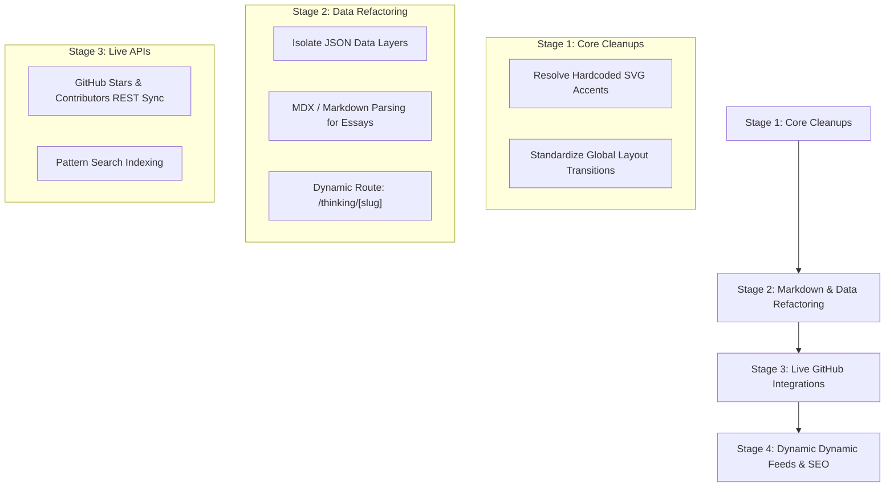

# Roadmap & Gap Analysis — uxe.fyi

This document provides a comprehensive audit of the differences between the original single-file prototype (`context/`) and the newly migrated production-ready **Next.js + TypeScript + Vanilla CSS** application (`src/`). It highlights active gaps, loops, dead links, and charts out a modular roadmap for future feature implementation.

---

## 🔍 Found Gaps & Loopholes

### 1. The Dynamic Accent Color Syncing in Custom SVG/Canvas Elements
*   **Gap**: While the `ThemeProvider` successfully updates `document.body` variables, some components or SVG attributes (e.g. inside `src/components/Demos.tsx`) have hardcoded colors (like `#FF3D88`) instead of utilizing CSS variables.
*   **Impact**: When a user changes the accent dot in the Navigation settings panel, some SVG lines and graphs in the live demos remain static pink.
*   **Fix**: Update all inline styles and SVG/canvas colors to use `var(--accent)` or dynamic context variables.

### 2. Dead RSS Feed Link (`/feed.xml`)
*   **Gap**: The footer contains a link to `/feed.xml` for an RSS stream (`<Link href="/feed.xml">RSS</Link>`).
*   **Impact**: Clicking this currently results in a Next.js `404 Not Found` page because there is no XML feed generator mapped under the `src/app/` router.
*   **Fix**: Construct a dynamic Next.js Route Handler at `src/app/feed.xml/route.ts` that compiles all published thinking essays into a valid RSS XML structure at build time.

### 3. Static Datastore Hardcoding (No Headless Data Layer)
*   **Gap**: Content arrays like `ESSAYS`, `ROADMAPS`, `RESOURCES`, and `CONTRIBUTORS` are declared as static JS constants inside their respective page files (e.g. `src/app/thinking/page.tsx`).
*   **Impact**: Non-technical authors cannot write or edit essays/resources without opening pull requests modifying source TSX files.
*   **Fix**: Migrate these data arrays into independent local JSON files (e.g. `src/data/`) or setup a lightweight Markdown/MDX parsing compiler so essays can be written in native `.md` files.

### 4. Community Page Live GitHub Integration Loophole
*   **Gap**: The community dashboard displays static placeholder metrics for contribution counts, stargazers, and GitHub activity logs.
*   **Impact**: The stats do not reflect real-time GitHub activity or contribution lists.
*   **Fix**: Wire up the GitHub REST API (`https://api.github.com/repos/sidhanshumonga/uxe.fyi`) inside a Next.js `generateStaticParams` builder or dynamic client-side `SWR`/`React Query` call to fetch stars, issues, and active contributor profiles.

### 5. No Single Essay View (Thinking Route Limitations)
*   **Gap**: The `/thinking` page lists 8 editorial essay drafts. Tapping any draft redirects outward to the repository's GitHub Issues.
*   **Impact**: There is no dedicated single-essay route (e.g. `/thinking/[slug]/page.tsx`) equipped to render actual compiled article content.
*   **Fix**: Set up dynamic route structures `/thinking/[slug]` utilizing Next.js static generation parameters to render complete article pages.

### 6. Subpage SEO Specificity
*   **Gap**: Right now, subpages like `/learning`, `/explore`, and `/breakdowns` inherit default metadata variables directly from the root layout.
*   **Impact**: Search engines display generic layout titles and descriptions for all subpages.
*   **Fix**: Export specific `metadata: Metadata` configuration blocks on each page.

---

## 🗺️ Architectural Roadmap

### Stage 1: Polishing and Visual Integrity (High Priority)
*   [ ] **Standardize accent colors**: Audit all custom SVG files, segmented control graphics, and charts. Rebind all `stroke` and `fill` colors to `var(--accent)`.
*   [ ] **Smooth page transitions**: Enhance Next.js routing with Framer Motion or native View Transitions API to match the prototype's smooth page-body switches.

### Stage 2: Markdown & Content Architecture (Medium Priority)
*   [ ] **Create content directory**: Relocate mock lists into local JSON files:
    *   `src/data/learning.json`
    *   `src/data/resources.json`
    *   `src/data/roadmaps.json`
*   [ ] **Markdown Parsing Setup**: Install `gray-matter` and `next-mdx-remote` (or configured unified pipelines) to dynamically load and display essays from a physical `/content/essays/` folder.
*   [ ] **Single-View Essays**: Initialize dynamic routes under `src/app/thinking/[slug]/page.tsx` for clean article layouts.

### Stage 3: Live API & Integration Phase (Low Priority)
*   [ ] **Live GitHub Integrations**: Re-route the mock community stats cards to dynamically query the live GitHub repository endpoints.
*   [ ] **Interactive Search Indexing**: Refactor the Fuzzy Search interactive panel in the `Breakdowns` component to search across the entire dictionary of resources and learning modules dynamically rather than a simulated string array.

### Stage 4: Feeds & SEO Optimization (SEO Priority)
*   [ ] **Dynamic RSS Generation**: Configure `scripts/generate-rss.mjs` to automatically compile essays into a valid `feed.xml` inside `/public` during production builds.
*   [ ] **SEO Optimization**: Inject explicit page-level metadata configurations for tailored titles and descriptions:
    *   *Explore*: `"What is UX Engineering?"`
    *   *Thinking*: `"UXE Thinking — Short, Opinionated Essays"`
    *   *Roadmaps*: `"Step-by-Step UX Engineering Learning Paths"`
